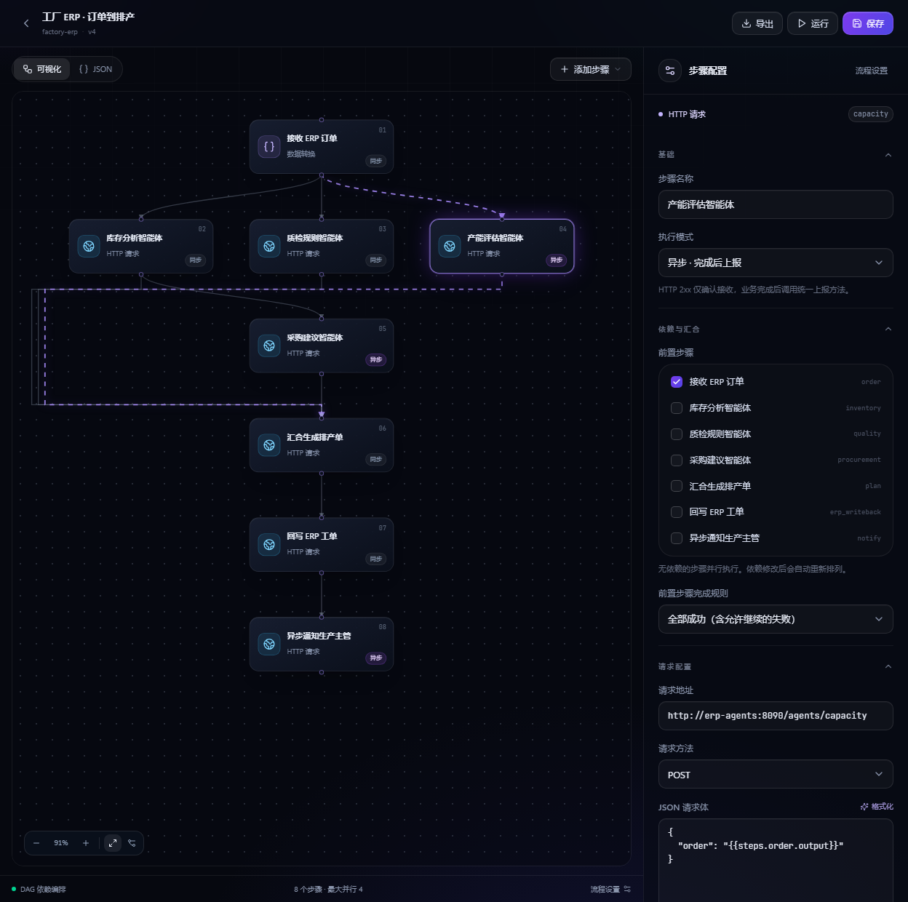

# FlowForge

A lightweight workflow scheduler for business systems and AI applications. Compose synchronous HTTP calls, asynchronous agents, parallel branches and durable waits through a React console or JSON definitions.

[中文文档](README.md) · [Worker integration](docs/async-workers.md) · [OpenAPI](internal/httpapi/openapi.yaml)



## Try the factory ERP demo

```bash
node scripts/init-env.mjs
docker compose -f compose.yaml -f compose.demo.yaml --profile app up --build -d --wait
```

Open http://localhost:8088 and sign in with `FLOWFORGE_API_TOKEN` from your local `.env`. Run **工厂 ERP · 订单到排产**. Its input is prefilled.

The example accepts an order, runs inventory, quality and capacity agents in parallel, waits for asynchronous capacity and procurement reports, generates a production plan, writes an ERP work order and sends an asynchronous notification. Agents use deterministic local data; no model keys or ERP account are required.

## Features

- DAG dependencies, parallel execution, conditional steps and join policies.
- Explicit `execution_mode: sync | async` on each step.
- Go worker SDK with `Reporter.Succeed`, `Reporter.Fail` and `Reporter.Report`.
- Durable PostgreSQL queue, leases, stale-worker fencing and immutable run snapshots.
- Exponential retry, failure propagation, time windows and timezone-aware Cron.
- API, authenticated webhooks, scheduled runs, cancellation, replay and event history.
- React / TailwindCSS / Vite console with an auto-fitting graph and JSON import/export.

Delivery is at least once. Receivers must deduplicate external side effects using `Idempotency-Key`. A 2xx response to an asynchronous dispatch acknowledges receipt; only a completion report advances dependent steps.

## Development

Go 1.25+, Node 22+ and PostgreSQL 17 are required for native development. Windows users can run `scripts/dev.ps1 -Hmr` for Vite hot reload with the API on 8088, or `scripts/dev.ps1` to build the console and serve the bundle from Go. Docker deployment does not require a local Go toolchain. See [deployment](docs/deployment.md) and [testing](docs/testing.md).

This release targets one trusted workspace per deployment. Multi-tenant authorization, RBAC, SSO, billing, dynamic subworkflows and arbitrary scripts are outside its current scope. Redis is optional infrastructure and is not used by the scheduler.

Before publishing the Go SDK, run `scripts/configure-repository.mjs` with the actual GitHub repository URL. Source packaging and commit checks are documented in [release preparation](docs/releasing.md).

Licensed under the [MIT License](LICENSE).
