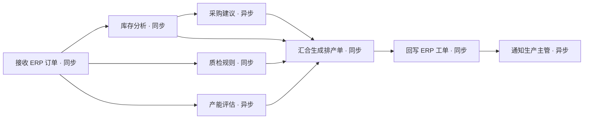

# FlowForge

面向企业系统与 AI 应用的轻量工作流调度平台。

通过可视化表单编排 HTTP 服务、智能体和后台任务，组合串行、并行与异步执行。使用 PostgreSQL 保存队列、步骤结果和执行历史，支持失败重试、时间窗口与定时触发。

[English](README.en.md) · [快速体验](#快速体验) · [工厂 ERP 示例](docs/erp-demo.md) · [异步任务接入](docs/async-workers.md) · [API](internal/httpapi/openapi.yaml)


## 可以用来做什么

| 场景 | 一条工作流可以完成的事情 |
| --- | --- |
| 工厂 ERP | 订单进入后并行分析库存、质检和产能；异步生成采购建议；汇合生成排产单并回写 ERP |
| 多智能体应用 | 并行检索与分析，等待长耗时智能体上报，再汇总结果、触发后续服务 |
| 数据与文档处理 | 文件地址入队，异步抽取与审核，失败重试，输出结果交给下游系统 |
| 定时后台任务 | 在指定时区和时间窗口运行同步、报表或批处理，保留每一步的状态和输出 |

### 工厂 ERP：订单到排产

八个步骤同时覆盖同步、异步、串行、并行、失败重试和结果汇合。演示服务返回确定性数据，不需要模型密钥或真实 ERP 账号。




异步任务返回 `202` 后，工作流保留等待状态；开发者在业务内部执行完成后调用统一上报方法，依赖它的步骤才会继续。


## 快速体验

### Docker 演示

需要 Docker Desktop / Docker Compose。Node 22+ 用于跨平台配置脚本；Windows 也可以直接运行 PowerShell 脚本。

```bash
# 生成本地随机凭据，不覆盖已有配置
node scripts/init-env.mjs

# 启动平台、PostgreSQL 和本地演示智能体
docker compose -f compose.yaml -f compose.demo.yaml --profile app up --build -d --wait
```

Windows 一条命令：

```powershell
.\scripts\demo.ps1
```

打开 **http://localhost:8088**，使用本地 `.env` 中的 `FLOWFORGE_API_TOKEN` 登录。选择 **工厂 ERP · 订单到排产**，点击“运行”。输入框已填好订单数据，约十几秒后可查看排产、采购建议和 ERP 工单结果。

默认示例让库存服务第一次返回 `503`，随后自动重试成功。将输入中的 `scenario.notification_failure` 改成 `true`，可以观察非关键通知失败而主流程仍成功；将 `scenario.quality_reject` 改成 `true`，可以观察关键步骤失败后停止流程。

### 标准部署

```bash
node scripts/init-env.mjs
docker compose --profile app up --build -d --wait
```

标准部署不启动演示智能体。修改环境变量和出站访问策略后，可接入实际业务服务。停止演示用：

```bash
docker compose -f compose.yaml -f compose.demo.yaml --profile app down
```

此命令保留 PostgreSQL 数据卷。配置详情见 [部署指南](docs/deployment.md)。

## 核心能力

| 能力 | 配置与行为 |
| --- | --- |
| 依赖编排 | `depends_on` 构建 DAG，相互无依赖的步骤可并行；拒绝循环依赖 |
| 执行模式 | 每个步骤包含 `execution_mode`；HTTP 可选 `sync` 或 `async` |
| 同步 HTTP | 等待 2xx 响应，将结果保存为 `output.status_code` 与 `output.body` |
| 异步 HTTP | 2xx 只表示接收，业务内部通过 SDK / HTTP 上报成功或失败 |
| 数据映射 | `transform` 保留 JSON 类型，引用输入和前置步骤的输出 |
| 持久化延时 | `delay` 不占 Worker，到期由引擎自动完成 |
| 重试 | 总尝试次数、指数退避和退避上限，等待信息保存在数据库 |
| 失败策略 | 停止流程、允许继续或阻断依赖分支；可独立配置是否影响最终结果 |
| 汇合与条件 | `all_success`、`all_done`、`any_success`；支持 `eq`、`ne`、`exists` |
| 触发方式 | 手动、API、鉴权 Webhook、带时区 Cron、单次计划执行与历史重跑 |
| 时间窗口 | 指定时区和星期，支持跨午夜；限制新步骤启动 |
| 并发控制 | 进程 Worker 数、实例内并行数、跨进程共享的活动实例上限 |
| 可追踪执行 | 定义版本快照、步骤输出、事件时间线、取消与原快照重跑 |
| 故障恢复 | 数据库事务、`SKIP LOCKED`、租约续期、过期接管与写回隔离 |

队列使用 PostgreSQL。Redis 有可选部署入口，当前不参与调度。执行语义为**至少一次**，外部服务应根据幂等键去重；详见 [架构与执行语义](docs/architecture.md)。

## 同步与异步如何配置

```json
{
  "id": "order-pipeline", "name": "订单处理", "enabled": true,
  "steps": [
    {
      "id": "inventory", "type": "http", "execution_mode": "sync",
      "config": { "url": "https://services.example.com/inventory", "body": "{{input}}" }
    },
    {
      "id": "planning", "type": "http", "execution_mode": "async",
      "depends_on": ["inventory"], "timeout_seconds": 300,
      "config": { "url": "https://services.example.com/planning", "body": "{{steps.inventory.output.body}}" }
    }
  ]
}
```

异步服务接收请求时提取上下文，将上报器交给内部业务函数：

```go
task, err := worker.FromRequest(r, worker.WithAllowedOrigin(platformOrigin))
if err != nil { return err }
// 将任务交给自己的后台队列，再返回 202。
// 在业务函数完成事务、保存结果后调用：
err = task.Reporter.Succeed(ctx, result)
// 业务失败时：task.Reporter.Fail(ctx, businessError)
```

统一 HTTP 接口为 `POST /api/v1/callbacks/{token}`，支持 `succeeded`、`failed`，每次尝试有独立限时令牌。完整 SDK 用法、后台队列接入和幂等规则见 [异步开发指南](docs/async-workers.md)。

## 文档

- [工厂 ERP 演示](docs/erp-demo.md)：数据、步骤关系、故障场景与真实服务替换。
- [工作流配置](docs/workflows.md)：步骤、模板、模式、依赖和失败传播。
- [异步开发指南](docs/async-workers.md)：统一上报 SDK、HTTP 协议与内部调用方式。
- [部署与配置](docs/deployment.md)：环境变量、网络策略、数据库及本地开发。
- [架构与执行语义](docs/architecture.md)：队列、租约、恢复和实现边界。
- [开发与测试](docs/testing.md)：测试命令及覆盖范围。
- [发布与提交范围](docs/releasing.md)：文件白名单、大小限制、敏感配置检查及源码打包。
- [OpenAPI](internal/httpapi/openapi.yaml)：流程、触发、实例和上报接口。

## 技术栈与范围

Go 1.25、React 19、TypeScript、TailwindCSS 4、Vite、PostgreSQL 17 和 Docker Compose。

当前面向单个可信工作空间独立部署。暂不包含租户隔离、用户/RBAC、SSO、计费、任意脚本、循环和动态子流程；同批同步请求完成后才推进下一批。HTTP 请求/结果使用 JSON，单次请求体和响应上限 1 MiB，大文件应传存储地址。

欢迎通过 Issue 和 Pull Request 参与，参见 [贡献指南](CONTRIBUTING.md) 与 [安全说明](SECURITY.md)。项目采用 [MIT License](LICENSE)。
