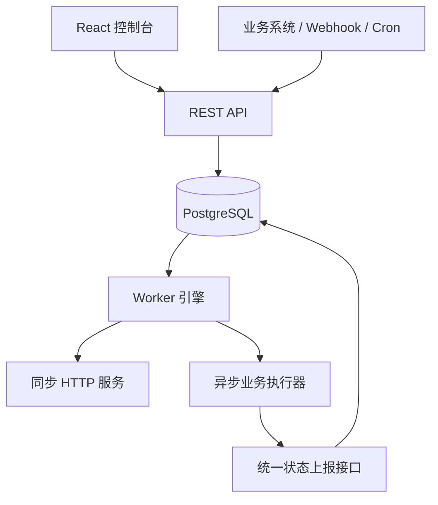

# 架构与执行语义

## 模块

| 目录 | 责任 |
| --- | --- |
| `pkg/workflow` | 定义契约、DAG 校验、执行模式、模板与时间规则 |
| `pkg/worker` | 异步执行元数据与统一状态上报 SDK |
| `internal/engine` | 就绪判定、并发执行、失败传播与等待推进 |
| `internal/store` | 队列、租约、事务、回调和实例快照 |
| `internal/httpapi` | REST API、鉴权、静态控制台与 OpenAPI |
| `examples/erp` | 可运行定义、订单数据和演示智能体服务 |
| `web` | React 流程配置与执行追踪 |

引擎不判断订单、案件、客户或其他业务字段。业务输入是 JSON，对接服务自行负责领域校验和事务。

## 入队和执行

1. 入队事务读取定义，将版本快照、输入、初始步骤和排队事件一起提交。相同流程下相同幂等键复用原实例。
2. Worker 先锁定流程行，检查跨进程活动实例名额，再通过 `FOR UPDATE SKIP LOCKED` 领取到期实例。已开始的延时、回调等待也保留流程名额。
3. 每次领取递增 fence。外部请求分发前保存尝试次数和状态；异步步骤在分发前就进入等待，支持提前到达的结果。
4. 同一批就绪同步请求通过 Go 1.25 `sync.WaitGroup.Go` 并行。所有同步结果保存后再推进下一批。异步请求收到接收响应后释放 Worker，不阻塞其他就绪分支。
5. 重试、延时与窗口等待保存在 `next_at`。回调提交时将实例提前唤醒，并防止唤醒时间被 Worker 的并发保存覆盖。
6. 最终状态按显式的传播与影响策略计算；步骤状态和执行事件在同一事务提交。

## 租约和恢复

Worker 按租约周期的三分之一续期。每次保存都匹配 ID、owner、fence 和有效租约，过期 Worker 无法覆盖后继结果。

接管时发现同步步骤仍为 `running`，表示上一尝试结果未知；按剩余尝试次数重新安排或失败。异步步骤继续等待已持久化的回调/超时。服务退出会取消当前执行，未保存结果由租约到期后的接管处理。

这不能构成跨数据库和远端服务的恰好一次事务。请求成功后、状态写入前进程仍可能退出，接收方必须对副作用进行幂等处理。

## 限时上报

每次异步尝试生成独立随机令牌，数据库只存 SHA-256 哈希。回调按尝试次数和当前状态检查；旧尝试、过期令牌和已取消实例不能推进。相同终态重复上报被确认，不覆盖首次结果；冲突终态返回 `409`。

取消使实例所有权立即失效。活动 HTTP 请求在下一次心跳或自身超时后收到取消，但已经发生的外部副作用不能回滚。

## 边界

PostgreSQL 是状态和可靠队列的唯一事实来源，没有 Redis/数据库双写。Redis 当前仅预留部署入口。

执行按批推进，尚未实现逐节点流式推进、动态 DAG、循环、子流程、跨流程资源池和全局速率限制。HTTP 响应最多 1 MiB，多个步骤的结果会累积到快照中；大数据应使用外部存储引用。

当前仅提供一个可信工作空间的共享令牌模型。多租户、RBAC、SSO 和完整审计属于后续扩展范围。
