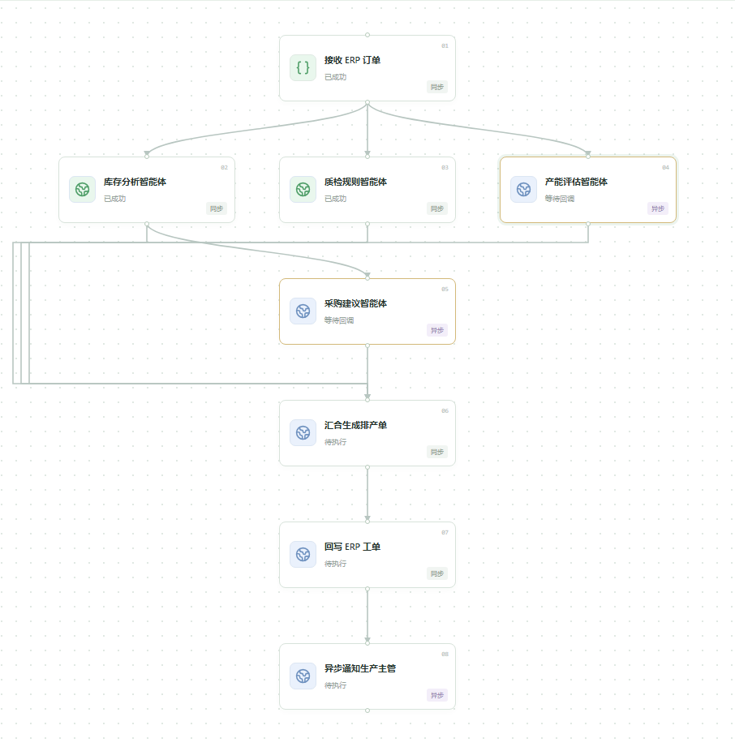
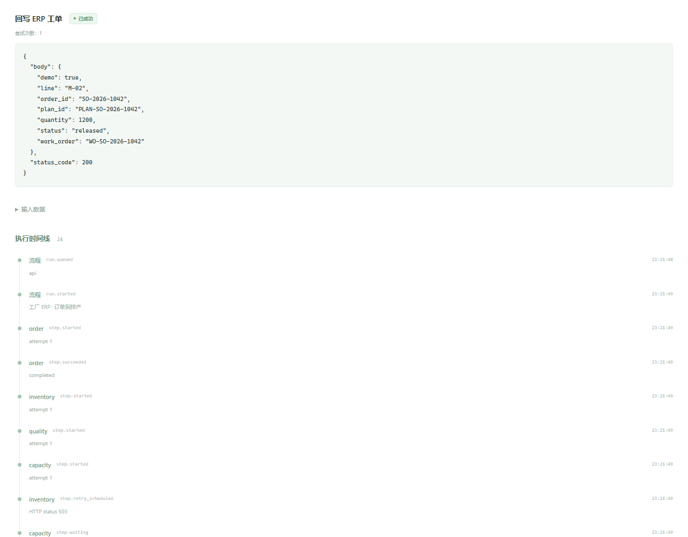

# 工厂 ERP：从销售订单到排产工单

平台负责依赖、并发、重试、超时和状态推进；智能体服务负责自己的业务逻辑。本例展示企业如何将多个独立智能体接成一条可跟踪的订单处理流程。

## 启动

```bash
node scripts/init-env.mjs
docker compose -f compose.yaml -f compose.demo.yaml --profile app up --build -d --wait
```

Windows 也可运行 `scripts/demo.ps1`。访问 http://localhost:8088，使用 `.env` 中的令牌登录，选择 **工厂 ERP · 订单到排产** 并运行。启用演示后会创建示例定义，不覆盖已存在的同名 ID。


## 示例订单

数据文件：[input.json](../examples/erp/input.json)，流程文件：[workflow.json](../examples/erp/workflow.json)。

| 字段 | 示例值 |
| --- | --- |
| 销售订单 | SO-2026-1042 |
| 客户 | 华东精密设备有限公司（虚构示例） |
| 产品 | SERVO-MOTOR-A1 |
| 数量 | 1,200 台 |
| 仓库 | 华东成品仓 |
| 交付日期 | 2026-11-05 |

## 八个步骤

| 步骤 ID | 功能 | 模式 | 前置步骤 |
| --- | --- | --- | --- |
| `order` | 映射 ERP 订单 | 同步 | 无 |
| `inventory` | 分析库存，计算可用量与缺口 | 同步 HTTP | `order` |
| `quality` | 返回检查项与质检方案 | 同步 HTTP | `order` |
| `capacity` | 评估生产线和日生产能力 | 异步 HTTP，上报完成 | `order` |
| `procurement` | 根据库存缺口生成采购建议 | 异步 HTTP，上报完成 | `inventory` |
| `plan` | 汇总四个分析结果并生成排产单 | 同步 HTTP | 库存、质检、产能、采购 |
| `erp_writeback` | 返回已下达的示例 ERP 工单 | 同步 HTTP | `plan` |
| `notify` | 通知生产主管 | 异步 HTTP，上报完成 | `erp_writeback` |

库存、质检和产能在同一批并行启动。库存完成后，采购可以在产能仍运行时开始；排产等待四个结果齐备。通知为非关键步骤，失败不改变已完成的排产结果。



## 上报与结果

实现位于 [agents/server.go](../examples/erp/agents/server.go)。异步服务返回 `202` 后，后台函数完成业务处理，再调用 `task.Reporter.Succeed(ctx, output)` 或 `task.Reporter.Fail(ctx, businessError)`。

接收逻辑按 `Idempotency-Key` 去重业务执行，每次投递仍向该次尝试的地址上报。示例任务缓存和后台执行器使用内存，重启会清空；实际业务应使用自己的持久化队列和结果表。

正常结果包含可用库存 780 台、缺口 420 台、日生产能力 600 台、两天排产，以及采购申请 `PR-SO-2026-1042`、排产单 `PLAN-SO-2026-1042` 和工单 `WO-SO-2026-1042`。



这些是演示服务返回的数据，未访问实际模型或真实 ERP。替换步骤 URL、鉴权头和请求映射即可接入现有系统，无需改变调度与上报协议。

## 故障场景

修改运行输入的 `scenario`：

| 配置 | 现象 |
| --- | --- |
| `inventory_retry: true` | 库存首次返回 `503`，退避后重试成功，时间线记录重试事件 |
| `quality_reject: true` | 质检失败，流程停止，尚未完成的分支不再推进 |
| `notification_failure: true` | 通知上报失败，因 `affects_run: false`，流程最终仍成功 |

可同时运行多个订单，观察 `concurrency` 与 `max_active_runs` 的区别。修改定义只影响之后创建的实例。

演示 Compose 文件将回调地址设为 `http://app:8088`，供同一 Docker 网络内的智能体访问；浏览器仍使用 `http://localhost:8088`。平台仅允许访问 `erp-agents`。退出演示并恢复标准部署：

```bash
docker compose -f compose.yaml -f compose.demo.yaml --profile app down
docker compose --profile app up -d --wait
```

示例定义和历史保留在数据库中；标准部署不再启动演示服务。
